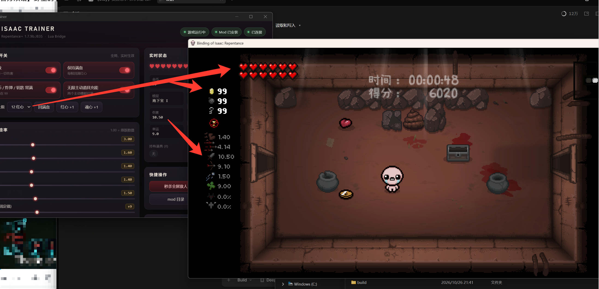

<div align="center">
    
    <h1>Issac Trainer</h1>
</div>

> [!WARNING]
> 本项目为使用Agent逆向Windows的《以撒的结合》客户端所构建，目前未测试在其它操作系统的可用性，但保证Windows可用

《以撒的结合：忏悔+》(The Binding of Isaac: Repentance+ `1.7.9b`) 的单机修改器。
Rust + Tauri 2 的桌面 UI，游戏侧走**官方 Modding API**（一个配套 Lua mod），
不读写进程内存、不注入 DLL、不改可执行文件。

```
┌────────────────────────────┐   invoke    ┌──────────────────────────┐
│  React UI (WebView2)       │ ──────────▶ │  Rust 后端                │
│  开关 / 滑条 / 物品搜索     │ ◀────────── │  · 定位游戏目录与存档      │
└────────────────────────────┘   ui-state  │  · 写 cmd.txt / 读 state  │
                                           └───────────┬──────────────┘
                                                       │ 文件 (4 帧轮询)
                                                       ▼
                                     mods/isaac_trainer/
                                       ├── main.lua      ← 官方 API 执行
                                       ├── metadata.xml
                                       ├── paths.lua
                                       └── bridge/
                                           ├── cmd.txt    设置 + 一次性动作
                                           ├── state.txt  血量/金币/楼层/种子…
                                           └── items.txt  物品 id → 本地化名称
```

## 为什么是这个方案

用 Binary Ninja 看过 `isaac-ng.exe`（32 位 MSVC，无壳，基址 `0x400000`）：

| 探测项 | 结果 |
| --- | --- |
| 版本字符串 | `Binding of Isaac: Repentance v1.7.9b.J835` @ `0xb5aa18` |
| 反作弊 | 无。仅 `steam_api.dll`（成就/云存档/创意工坊） |
| 脚本引擎 | 内嵌 Lua，启动即执行 `resources/scripts/main.lua` |
| 控制台 | `EnableDebugConsole`（options.ini）+ `giveitem` / `luarun` / `luamod` / `stage` 命令表 |
| Mod | `mods/` 目录 + `EnableMods`，官方 API 完整 |

纯内存修改需要逆出实体链表与静态全局指针，而且"给道具"必须注入代码调用引擎函数，
每次游戏更新都会失效。官方 API 能做同样的事且稳定，所以选它。

## 环境要求

- Windows 10/11 + WebView2（Win11 自带）
- Rust 1.77+、Node 18+
- 游戏：Repentance+ `1.7.9b`（1.7.9 其他小版本理论兼容）

## 开发 / 打包

```bash
npm install
npm run app:dev      # 开发模式（热重载）
npm run app:build    # 产出 src-tauri/target/release/isaac-trainer.exe
```

> `app:build` 用了 `--no-bundle`，只产出一个绿色 exe，不需要下载 WiX/NSIS。
> 想要安装包就改成 `npm run tauri build`。

## 首次使用

1. 启动本程序（会自动把 mod 写进 `mods/isaac_trainer/`，并把 `EnableMods` 设为 1）。
2. 启动游戏 → 主菜单 **Mods** → 勾选 **Isaac Trainer Bridge**。
3. 进一局游戏，右上角三个状态灯变绿即连通。
4. 之后所有开关都是实时的，不需要重启游戏。

如果状态一直是"未连接"：

- 看 `%USERPROFILE%\Documents\My Games\Binding of Isaac Repentance\log.txt`，
  搜 `[trainer]`：加载成功会打印 `bridge mod loaded, dir=...`。
- 界面里点 **bridge 目录**，确认 `state.txt` 的修改时间在跳动。
- 确认游戏里 Mods 菜单确实勾选了这个 mod（每个存档单独记录）。
- 改过 `EnableMods` 之后必须重启游戏才生效。

## 功能

| 分类 | 内容 |
| --- | --- |
| 作弊开关 | 无敌（拦截 `MC_ENTITY_TAKE_DMG`）、保持满血、金币/炸弹/钥匙常满 99、无限主动道具充能、红心上限 |
| 属性倍率 | 伤害、射速、移速、射程、弹速（倍率），幸运（固定值），作用于 `MC_EVALUATE_CACHE` |
| 物品 | 道具 / 饰品 / 卡牌 / 药丸，按中文名或 ID 搜索，点击即给 |
| 快捷操作 | 秒杀全屏敌人、一次性回满、+1 红心、+1 魂心、强制充满主动道具 |
| 实时状态 | 红心/魂心/黑心/骨心、金币炸弹钥匙、楼层、房间、种子、实际伤害/射速/移速、持有道具列表 |
| 设置 | 开关 `EnableMods` / `EnableDebugConsole`（写 options.ini）、手动指定游戏目录、重装/卸载 mod |

## 项目结构

```
src/                    React UI
  App.tsx               主界面
  api.ts                invoke 封装
  types.ts              与 Rust 结构体一一对应的类型
src-tauri/src/
  main.rs               入口
  lib.rs                Tauri 命令 + 状态轮询线程
  game.rs               游戏目录/存档目录/版本/options.ini
  bridge.rs             cmd.txt / state.txt 协议
  mod_install.rs        把 lua 目录内嵌进 exe，安装到 mods/
lua/isaac_trainer/      配套 mod 源码（编译时 include_str! 进 exe）
```

## 已知限制

- **成就**：使用控制台会打上"作弊标记"并影响成就；本方案走 mod 通道，但每日挑战/排行榜
  这类模式本身禁止 mod。要打成就请开新档正常玩。
- **每个存档要单独勾选 mod**（游戏机制，改 `persistentgamedata` 不安全）。
- 游戏大版本更新后如果 API 变了，需要更新 `main.lua`；UI 侧不用动。
- 联机用会被别人看到你在开挂，别干。

## 免责声明

仅供单机存档自用。不要用于联机对局、排行榜或任何形式的作弊对战。
